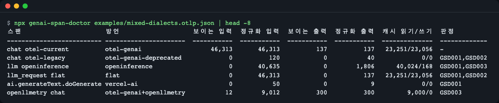
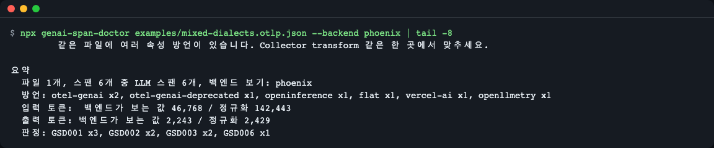
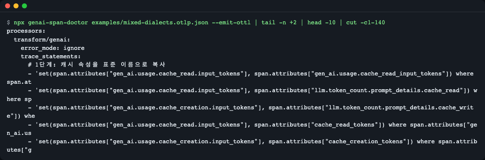
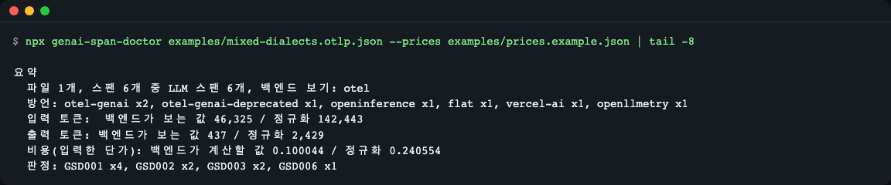
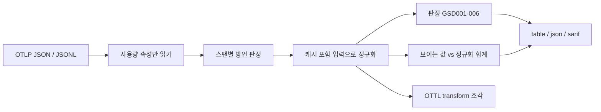

# genai-span-doctor

[English](README.md) | **한국어**

내보낸 OTLP 추적 파일을 읽어서, 어느 LLM 스팬이 어떤 토큰 속성 방언(OpenTelemetry GenAI, OpenInference, OpenLLMetry, Vercel AI SDK, 평면 키)을 쓰는지, 어느 스팬이 선택한 백엔드에서 토큰 0 으로 보이는지, 캐시 토큰이 "입력"에 들어 있는지 여부 때문에 어디가 과소 집계되는지 알려 주는 오프라인 CLI입니다. 고치기 전·후 토큰·비용 합계를 보여 주고, 그대로 붙여 넣을 수 있는 Collector transform(OTTL) 조각도 만들어 줍니다.


*섞인 추적 파일에 명령 하나: 스팬마다 방언, 백엔드가 읽을 수 있는 입력·출력 토큰("보이는 값"), 규약 의미로 맞춘 합계("정규화"), 판정이 나옵니다.*

## 이런 분께
- 여러 계측 라이브러리를 OpenTelemetry Collector 하나로 모으는데, 대시보드에서 일부 스팬의 토큰·비용이 0 으로 보입니다.
- 프롬프트 캐시를 켰더니 비용 그래프가 이상합니다. 캐시 토큰이 입력에서 빠졌거나 두 번 세어집니다.
- 계측 라이브러리나 규약 버전을 올리기 전후로 토큰 합계를 비교하고 싶습니다(녹화한 추적 파일로 CI 점검 포함).

## 설치
Node.js 20 이상이 필요합니다(`brew install node` 또는 [nodejs.org](https://nodejs.org/)). 실행 시 의존성은 없습니다.

```bash
npx genai-span-doctor --version
```

소스에서 설치(들어 있는 예제를 돌려 볼 때도 이 방법):

```bash
git clone https://github.com/LeeGyeongPil/genai-span-doctor.git
cd genai-span-doctor
npm install
npm run build
node dist/src/cli.js --version
```

소스 체크아웃에서 버전 명령의 실제 출력(2026-11-16):

```text
0.1.0
```

아래 명령은 `npx genai-span-doctor` 형태로 적었습니다. 소스 체크아웃에서는 `node dist/src/cli.js` 로 바꿔 쓰세요.

예제 경로(`examples/...`)는 소스 체크아웃 기준입니다. 위에서처럼 저장소를 먼저 clone 하고 그 안에서 명령을 실행하세요. 빈 작업 폴더에는 이 파일들이 없습니다.

## 빠르게 시작하기
```bash
npx genai-span-doctor examples/mixed-dialects.otlp.json --lang ko
```

실제 출력의 앞부분입니다(파일은 `examples/` 에 들어 있습니다).

```text
스팬                        방언                    보이는 입력  정규화 입력  보이는 출력  정규화 출력  캐시 읽기/쓰기  판정
--------------------------  ----------------------  -----------  -----------  -----------  -----------  --------------  -------------
chat otel-current           otel-genai                   46,313       46,313          137          137   23,251/23,056  -
chat otel-legacy            otel-genai-deprecated             0          120            0           40             0/0  GSD001,GSD002
llm openinference           openinference                     0       40,635            0        1,806      40,024/168  GSD001,GSD003
llm_request flat            flat                              0       46,313            0          137   23,251/23,056  GSD001,GSD002
ai.generateText.doGenerate  vercel-ai                         0           50            0            9             0/0  GSD001
openllmetry chat            otel-genai+openllmetry           12        9,012          300          300         9,000/0  GSD003
```

끝의 요약입니다.

```text
요약
  파일 1개, 스팬 6개 중 LLM 스팬 6개, 백엔드 보기: otel
  방언: otel-genai x2, otel-genai-deprecated x1, openinference x1, flat x1, vercel-ai x1, openllmetry x1
  입력 토큰:  백엔드가 보는 값 46,325 / 정규화 142,443
  출력 토큰: 백엔드가 보는 값 437 / 정규화 2,429
  판정: GSD001 x4, GSD002 x2, GSD003 x2, GSD006 x1
```

읽는 법:
- **보이는 값**: 선택한 백엔드가 스팬 속성에서 읽을 수 있는 값입니다(기본 보기 `otel` 은 `gen_ai.usage.input_tokens`·`gen_ai.usage.output_tokens` 만 읽습니다). `0` 이면 대시보드도 0 으로 보입니다.
- **정규화**: 규약 의미(입력에 캐시 읽기·쓰기 토큰 포함)로 맞춘 값입니다. `llm openinference` 스팬은 입력 443 을 보고하지만 옆에 캐시 토큰 40,192 가 있어서 정규화 입력은 40,635 입니다.
- `error` 판정이 있으면 종료 코드가 1 이라(`--fail-on` 참고) CI 점검으로 쓸 수 있습니다. 예제 파일은 일부러 걸리게 만들었습니다.

## 사용법
| 명령·옵션 | 하는 일 | 예 |
|---|---|---|
| `<파일>` | OTLP JSON(`ExportTraceServiceRequest`) 또는 Collector file 익스포터의 JSON Lines 점검 | `genai-span-doctor traces.json` |
| `<디렉터리>` | 아래의 모든 `*.json`, `*.jsonl` 점검(모두 OTLP 내보내기여야 함) | `genai-span-doctor ./traces` |
| `-` | 표준 입력에서 읽기 | `cat traces.jsonl \| genai-span-doctor -` |
| `--format table\|json\|sarif` | 보고서 형식(기본 `table`), `json` 은 `schemaVersion: 1` | `--format json` |
| `--backend otel\|langfuse\|phoenix` | "토큰 0" 판정에서 어떤 속성 이름을 읽을 수 있다고 볼지 | `--backend phoenix` |
| `--emit-ottl [파일.yaml]` | Collector `transform` 프로세서 생성. 파일을 안 주면 YAML 은 표준 출력, 보고서는 표준 오류 | `--emit-ottl transform.yaml` |
| `--ottl-delete-source` | 복사한 뒤 원래 속성도 삭제 | `--ottl-delete-source` |
| `--assume-cache-excluded <ids>` | 지정한 방언 id(쉼표 구분)는 "입력에 캐시 제외"로 간주 | `--assume-cache-excluded vercel-ai` |
| `--prices <파일>` | 100만 토큰당 단가 JSON, 비용 줄 추가 | `--prices examples/prices.example.json` |
| `--fail-on error\|warning\|note\|none` | 이 수준 이상 판정이 있으면 종료 코드 1(기본 `error`) | `--fail-on warning` |
| `--lang en\|ko` | 화면 언어 | `--lang ko` |
| `--version`, `--help` | 버전, 도움말 | |

종료 코드: `0` 정상, `1` `--fail-on` 이상 판정 있음, `2` 사용법·입력 오류(메시지에 파일 이름이 나옵니다).

방언 id: `otel-genai`, `openllmetry`, `otel-genai-deprecated`, `openinference`, `vercel-ai`, `flat`.

### 판정 목록

| ID | 뜻 |
|---|---|
| GSD001 | 백엔드가 스팬의 입력 또는 출력 토큰을 읽지 못해 0 으로 보임 |
| GSD002 | 지원 중단된 속성 이름(예: `gen_ai.system`, `gen_ai.usage.prompt_tokens`) |
| GSD003 | 캐시 토큰이 입력보다 커서 입력에 캐시가 빠졌을 가능성이 높고 합계가 과소 집계됨 |
| GSD004 | 한 스팬의 두 방언 값이 정규화 후에도 다름 |
| GSD005 | 합계가 입력+출력과 다름 |
| GSD006 | 한 파일에 방언이 여러 개 섞임 |

### 시나리오 1: 백엔드마다 왜 다르게 보일까
```bash
npx genai-span-doctor examples/mixed-dialects.otlp.json --backend phoenix --lang ko | tail -8
```


*`--backend phoenix` 로 보면 OpenInference 스팬이 보이게 되어, 보이는 입력이 46,325 에서 46,768 로, 보이는 출력이 437 에서 2,243 으로 늘어납니다. 그래도 읽는 `llm.token_count.prompt` 는 캐시를 뺀 값이라 입력은 정규화 142,443 보다 훨씬 작습니다.*

백엔드별 속성 목록은 출처 URL·확인 날짜와 함께 `data/backends.json` 에 있습니다.

### 시나리오 2: Collector 수정안 받기
```bash
npx genai-span-doctor examples/mixed-dialects.otlp.json --emit-ottl | tail -n +2 | head -10 | cut -c1-140
```


*생성된 `transform/genai` 프로세서의 앞부분입니다(명령의 `cut` 이 줄을 140자에서 자르며, 실제 YAML 은 온전합니다). 네 단계로 동작합니다. 캐시 속성 복사, 원본이 캐시를 뺀 경우 입력에 캐시 합산, 나머지 이름 복사, (선택) 원본 삭제.*

Collector 로 끝까지 돌려 보려면 `examples/collector.example.yaml` 을 보세요.

1. `npx genai-span-doctor traces.jsonl --emit-ottl transform.yaml`
2. `processors:` 블록을 Collector 설정에 붙이고 traces 파이프라인에 `transform/genai` 를 추가합니다.
3. Collector 를 돌린 뒤 출력을 다시 점검합니다: `npx genai-span-doctor out/traces.jsonl`. 변환은 캐시 토큰을 입력에 더하지만 합계 속성은 그대로 두므로, 합계가 따로 있는 스팬(예: OpenLLMetry)에는 GSD005 경고가 남을 수 있습니다.

OpenInference 입력은 캐시가 입력보다 클 때만 캐시와 합산하므로, 이미 캐시를 포함한 소스는 그대로 복사됩니다. 조각은 `otelcol-contrib` 0.165.0 으로 확인했습니다. 배포 전에 직접 검토하세요.

### 시나리오 3: 차이에 가격 붙이기
```bash
npx genai-span-doctor examples/mixed-dialects.otlp.json --prices examples/prices.example.json --lang ko | tail -8
```


*`examples/prices.example.json` 은 지어낸 값이지 실제 공급자 단가가 아닙니다. 본인 단가로 바꾸세요. 비용 줄은 백엔드가 계산할 값과 정규화한 값을 견줍니다.*

## 설정
- 화면 언어: `--lang en|ko`, 그다음 환경변수 `GENAI_SPAN_DOCTOR_LANG`, 그다음 `LC_ALL`, `LC_MESSAGES`, `LANG`(비어 있지 않은 첫 값이 결정, `ko` 로 시작하지 않으면 영어). JSON·SARIF 의 키와 규칙 ID 는 언어와 무관하고 메시지 문자열만 바뀝니다.
- 단가 파일: `{ "default": { "input", "output", "cache_read", "cache_write" }, "models": { ... } }`, 단위는 100만 토큰당 금액. `examples/prices.example.json` 참고.
- 네트워크도 API 키도 쓰지 않습니다. 프롬프트·응답 본문은 읽지 않습니다. 파서는 규칙 표에 있는 속성만 담습니다.

## 동작 원리


1. 파서는 파일을 읽어 `data/dialects.json` 에 이름이 있는 속성만 남기고 프롬프트 본문을 포함한 나머지는 버립니다.
2. 스팬은 자신이 가진 사용량 속성 이름에 해당하는 모든 방언에 매칭됩니다(겹치면 모두 기록).
3. 값은 규약 의미(입력에 캐시 읽기·쓰기 포함)로 정규화됩니다.
4. 선택한 백엔드 보기를 기준으로 판정과 "보이는 값 대 정규화" 합계를 계산합니다.
5. OTTL 생성기는 같은 규칙 표를 nil 검사가 붙은 `set(...)` 문으로 바꿉니다.

## 언제 쓰나
- 잘 맞는 상황: 토큰·비용 대시보드를 믿기 전에 녹화한 추적 파일이나 CI 픽스처를 점검할 때, Collector transform 초안을 얻을 때.
- 맞지 않는 상황: 하나의 규약 레지스트리 적합성 검사는 [OpenTelemetry Weaver](https://github.com/open-telemetry/weaver) 가 맞습니다. 실시간 트래픽도 대상이 아닙니다(이 도구는 파일만 읽습니다).

## 자주 겪는 문제
| 증상 | 원인 | 해결 |
|---|---|---|
| `nope.json 를 읽을 수 없습니다: …` 후 종료 코드 2 (영어 화면: `Cannot read nope.json: …`) | 경로 오류 | 경로 확인(메시지에 파일 이름이 나옵니다) |
| 보이는 값이 전부 0 | 선택한 백엔드 보기가 속성 이름을 읽지 못함 | `--backend langfuse` 또는 `phoenix` 로 보거나 `--emit-ottl` 로 변환 생성 |
| 캐시를 쓰는데 GSD003 이 안 나옴 | 입력이 캐시보다 작지 않아 휴리스틱이 판단 못 함 | `--assume-cache-excluded <방언 id>` |
| CI 에서 종료 코드 1 | `error` 판정이 있음 | 추적을 고치거나 `--fail-on none` 으로 보고만 받기 |
| `--emit-ottl` 이 알림만 내고 YAML 이 없음 | 이미 표준 이름을 씀 | 변환할 것이 없음 |

알려진 한계: 파일을 통째로 읽습니다(큰 JSONL 은 메모리를 씁니다). GSD006 은 파일 단위이고, `openllmetry` 처럼 다른 방언 위에 덧붙는 방언은 GSD006 의 개수에 세지 않습니다(그래서 요약의 방언 목록보다 하나 적을 수 있습니다). 디렉터리 모드는 OTLP 가 아닌 JSON 파일을 만나면 종료 코드 2 로 멈춥니다. 같은 ID 의 스팬이 아주 많이 반복되면 표 출력이 느려질 수 있습니다(`--format json` 은 빠릅니다). protobuf 입력과 실시간 수신은 지원하지 않습니다.

## 개발·기여
```bash
npm install
npm test
```

`npm test` 는 빌드 후 단위 테스트를 돌립니다. `OTELCOL_BIN` 이 `otelcol-contrib` 0.165.0 을 가리키면 Collector 종단 테스트도 돌고, 없으면 건너뜁니다. 버그·제안은 이슈로 남겨 주세요. 변경 기록은 [CHANGELOG.md](CHANGELOG.md).

## 출처
2026-11-16 확인.
- [OpenTelemetry GenAI 속성 레지스트리](https://opentelemetry.io/docs/specs/semconv/registry/attributes/gen-ai/)
- [OpenInference 규약](https://github.com/Arize-ai/openinference/blob/main/spec/semantic_conventions.md)
- [Vercel AI SDK 텔레메트리](https://ai-sdk.dev/docs/ai-sdk-core/telemetry)
- [Langfuse OpenTelemetry 매핑](https://langfuse.com/integrations/native/opentelemetry)
- [Collector transform 프로세서](https://github.com/open-telemetry/opentelemetry-collector-contrib/blob/main/processor/transformprocessor/README.md), [OTTL](https://github.com/open-telemetry/opentelemetry-collector-contrib/blob/main/pkg/ottl/README.md)

## 라이선스
MIT.
