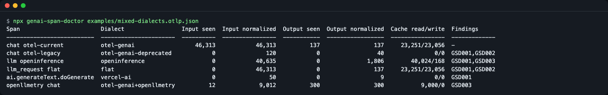
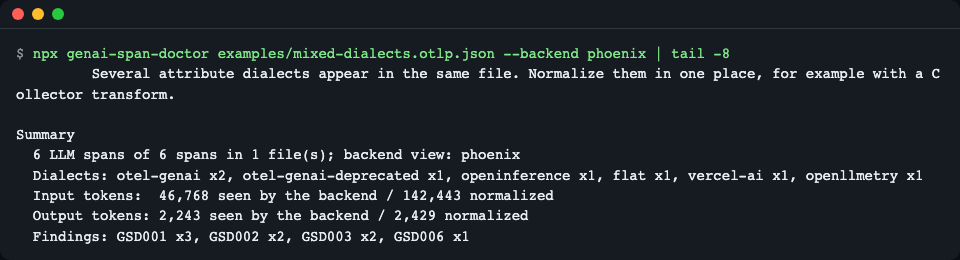
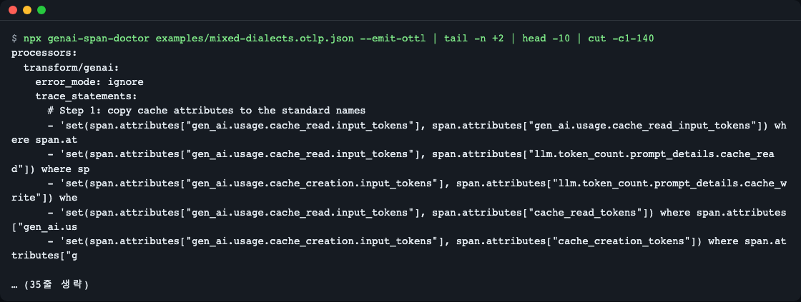
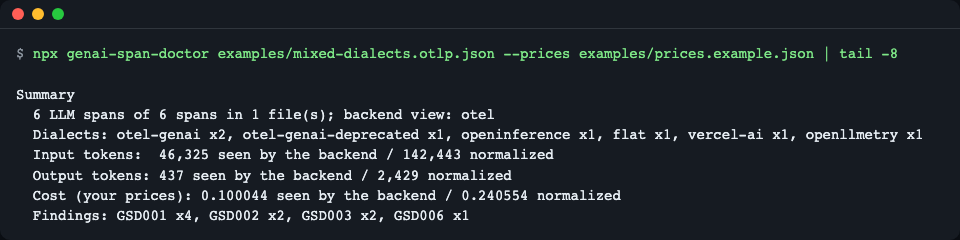
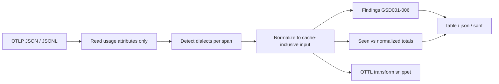

# genai-span-doctor

**English** | [한국어](README.ko.md)

An offline CLI that reads exported OTLP traces and tells you which LLM spans use which token-attribute dialect (OpenTelemetry GenAI, OpenInference, OpenLLMetry, Vercel AI SDK, flat keys), which of them your backend shows as 0 tokens, and which are under-counted because cache tokens are or are not part of "input". It prints before/after token and cost totals and can emit a ready-to-paste Collector transform (OTTL) snippet.


*One command on a mixed trace file: per span, the dialect, the input and output tokens a backend can read ("seen") and the spec-style totals ("normalized"), plus findings.*

## Who it is for
- Your dashboard shows 0 tokens or 0 cost for some spans, and you mix several instrumentation libraries behind one OpenTelemetry Collector.
- You turned on prompt caching and the cost chart looks wrong: the cache tokens are missing from input, or counted twice.
- You are upgrading an instrumentation library or a semantic-convention version and want to compare token totals before and after, including in CI on recorded trace files.

## Install
Requires Node.js 20 or newer (`brew install node`, or see [nodejs.org](https://nodejs.org/)). There are no runtime dependencies.

```bash
npx genai-span-doctor --version
```

From source (also the way to try the bundled examples):

```bash
git clone https://github.com/LeeGyeongPil/genai-span-doctor.git
cd genai-span-doctor
npm install
npm run build
node dist/src/cli.js --version
```

Output of the version command in a source checkout, 2026-11-16:

```text
0.2.0
```

The commands below use the `npx genai-span-doctor` form. In a source checkout, write `node dist/src/cli.js` instead.

The example paths (`examples/...`) are relative to a source checkout, so clone the repository first as shown above and run the commands inside it. They do not exist in an empty working folder.

## Quick start
```bash
npx genai-span-doctor examples/mixed-dialects.otlp.json
```

The first part of the real output (the file ships in `examples/`):

```text
Span                        Dialect                 Input seen  Input normalized  Output seen  Output normalized  Cache read/write  Findings
--------------------------  ----------------------  ----------  ----------------  -----------  -----------------  ----------------  -------------
chat otel-current           otel-genai                  46,313            46,313          137                137     23,251/23,056  -
chat otel-legacy            otel-genai-deprecated            0               120            0                 40               0/0  GSD001,GSD002
llm openinference           openinference                    0            40,635            0              1,806        40,024/168  GSD001,GSD003
llm_request flat            flat                             0            46,313            0                137     23,251/23,056  GSD001,GSD002
ai.generateText.doGenerate  vercel-ai                        0                50            0                  9               0/0  GSD001
openllmetry chat            otel-genai+openllmetry          12             9,012          300                300           9,000/0  GSD003
```

And the summary at the end:

```text
Summary
  6 LLM spans of 6 spans in 1 file(s); backend view: otel
  Dialects: otel-genai x2, otel-genai-deprecated x1, openinference x1, flat x1, vercel-ai x1, openllmetry x1
  Input tokens:  46,325 seen by the backend / 142,443 normalized
  Output tokens: 437 seen by the backend / 2,429 normalized
  Findings: GSD001 x4, GSD002 x2, GSD003 x2, GSD006 x1
```

How to read it:
- **seen**: what the selected backend can read from the span's attributes (default view `otel`: only `gen_ai.usage.input_tokens` and `gen_ai.usage.output_tokens`). `0` means the dashboard shows 0.
- **normalized**: the value in the spec meaning, where input includes cache read and cache write tokens. The `llm openinference` span reports 443 input tokens, but 40,192 cache tokens sit beside it, so the normalized input is 40,635.
- The exit code is 1 when an `error` finding exists (see `--fail-on`), so the command works as a CI check. The example file triggers it on purpose.

## Usage
| Command / option | What it does | Example |
|---|---|---|
| `<file>` | Audit an OTLP JSON file (`ExportTraceServiceRequest`) or JSON Lines from the Collector file exporter | `genai-span-doctor traces.json` |
| `<directory>` | Audit every `*.json` and `*.jsonl` file below it (JSON files that are not OTLP exports are skipped and listed) | `genai-span-doctor ./traces` |
| `-` | Read from standard input | `cat traces.jsonl \| genai-span-doctor -` |
| `--format table\|json\|sarif` | Report format (default `table`); `json` carries `schemaVersion: 1` | `--format json` |
| `--backend otel\|langfuse\|phoenix` | Which attribute names count as "readable" when deciding what shows 0 | `--backend phoenix` |
| `--emit-ottl [file.yaml]` | Generate a Collector `transform` processor; without a file, YAML goes to stdout and the report to stderr | `--emit-ottl transform.yaml` |
| `--ottl-delete-source` | Also delete the original attributes after copying | `--ottl-delete-source` |
| `--assume-cache-excluded <ids>` | Treat the given dialect ids (comma separated) as "input excludes cache" | `--assume-cache-excluded vercel-ai` |
| `--prices <file>` | Per-1M-token prices JSON; adds a cost line | `--prices examples/prices.example.json` |
| `--fail-on error\|warning\|note\|none` | Exit 1 at this level or higher (default `error`) | `--fail-on warning` |
| `--lang en\|ko` | Screen language | `--lang ko` |
| `--version`, `--help` | Version, help | |

Exit codes: `0` fine, `1` a finding at or above `--fail-on`, `2` usage or input error (the message names the file).

Dialect ids: `otel-genai`, `openllmetry`, `otel-genai-deprecated`, `openinference`, `vercel-ai`, `flat`.

### Findings

| ID | Meaning |
|---|---|
| GSD001 | The backend cannot read the span's input or output tokens, so it shows 0 |
| GSD002 | Deprecated attribute name (for example `gen_ai.system`, `gen_ai.usage.prompt_tokens`) |
| GSD003 | Cache tokens exceed input, so input likely excludes cache and totals are under-counted |
| GSD004 | Two dialects on one span disagree after normalization |
| GSD005 | The total does not match input plus output |
| GSD006 | Several dialects are mixed in one file |

### Scenario 1: why does one backend show less?
```bash
npx genai-span-doctor examples/mixed-dialects.otlp.json --backend phoenix | tail -8
```


*With `--backend phoenix`, the OpenInference span becomes visible, so seen input rises from 46,325 to 46,768 and seen output from 437 to 2,243. The `llm.token_count.prompt` it reads still excludes the cache, which is why input stays far below the normalized 142,443.*

The per-backend attribute lists live in `data/backends.json` with their source URLs and check dates.

### Scenario 2: get the Collector fix
```bash
npx genai-span-doctor examples/mixed-dialects.otlp.json --emit-ottl | tail -n +2 | head -10 | cut -c1-140
```


*The start of the generated `transform/genai` processor (lines cut at 140 characters by the `cut` in the command, the real YAML is complete), which works in four steps: copy cache attributes, sum cache into input where the source excludes it, copy the remaining names, optionally delete the sources.*

To run it end to end with a Collector, see `examples/collector.example.yaml`:

1. `npx genai-span-doctor traces.jsonl --emit-ottl transform.yaml`
2. Paste the `processors:` block into your Collector config and add `transform/genai` to the traces pipeline.
3. Run the Collector, then audit its output again: `npx genai-span-doctor out/traces.jsonl`. The transform adds cache tokens into input but leaves total attributes as they are, so spans that carry their own total (for example OpenLLMetry) may still show a GSD005 warning.

The OpenInference input is only summed with cache tokens when the cache is larger than the input, so a source that already includes the cache is copied unchanged. The snippet has been checked against `otelcol-contrib` 0.165.0. Review it before deploying.

### Scenario 3: put a price on the gap
```bash
npx genai-span-doctor examples/mixed-dialects.otlp.json --prices examples/prices.example.json | tail -8
```


*`examples/prices.example.json` holds made-up prices, not real provider prices. Replace them with your own. The cost line compares what the backend computes with the normalized total.*

## Configuration
- Screen language: `--lang en|ko`, then the `GENAI_SPAN_DOCTOR_LANG` environment variable, then `LC_ALL`, `LC_MESSAGES`, `LANG` (the first non-empty one decides; anything that does not start with `ko` means English). JSON and SARIF keys and rule IDs never change with the language, only message text.
- Prices file: `{ "default": { "input", "output", "cache_read", "cache_write" }, "models": { ... } }`, in currency units per 1M tokens. See `examples/prices.example.json`.
- No network access and no API keys. Prompt and response text is never read: the parser keeps only the attributes listed in the rule tables.

## How it works


1. The parser reads the file and keeps only the attributes named in `data/dialects.json`; everything else, including prompt text, is dropped.
2. Each span is matched to every dialect whose usage attribute names it carries (overlaps are all recorded).
3. Values are normalized to the spec meaning: input includes cache read and write tokens.
4. Findings and the seen-vs-normalized totals are computed against the chosen backend view.
5. The OTTL generator turns the same rule table into `set(...)` statements with nil guards.

## When to use it
- Good fit: spot-checking a recorded trace file or a CI fixture before you trust token and cost dashboards, and generating a first draft of a Collector transform.
- Not a fit: checking one convention registry for conformance, which [OpenTelemetry Weaver](https://github.com/open-telemetry/weaver) is built for; live traffic, because this tool only reads files.

## Troubleshooting
| Symptom | Cause | Fix |
|---|---|---|
| `Cannot read nope.json: no such file or directory` and exit 2 | Wrong path | Check the path; the message names the file |
| Everything shows 0 seen | The backend view does not read your attribute names | Run with `--backend langfuse` or `phoenix`, or generate a transform with `--emit-ottl` |
| No GSD003 although you use caching | Input is not smaller than the cache, so the heuristic cannot tell | Pass `--assume-cache-excluded <dialect ids>` |
| Exit code 1 in CI | An `error` finding exists | Fix the traces, or use `--fail-on none` to only report |
| `--emit-ottl` prints a note and no YAML | The traces already use the standard names | Nothing to transform |

Known limits: files are read whole (large JSONL files use memory). GSD006 is per file and does not count overlay dialects such as `openllmetry`, so its count can be one lower than the Summary dialect list. In directory mode, JSON files without a `resourceSpans` array are skipped and reported as `Skipped: <file>` (`skipped` in JSON, `properties.skipped` in SARIF); exit 2 only when no OTLP file is left. A single non-OTLP file or stdin still exits 2. Table output can slow down when very many spans repeat the same ids (`--format json` stays fast). Protobuf input and live receiving are not supported.

## Development
```bash
npm install
npm test
```

`npm test` builds and runs the unit tests; an optional Collector end-to-end test runs when `OTELCOL_BIN` points to `otelcol-contrib` 0.165.0 and is skipped otherwise. Bugs and ideas are welcome as issues. Changes are listed in [CHANGELOG.md](CHANGELOG.md).

## Sources
Checked 2026-11-16.
- [OpenTelemetry GenAI attribute registry](https://opentelemetry.io/docs/specs/semconv/registry/attributes/gen-ai/)
- [OpenInference semantic conventions](https://github.com/Arize-ai/openinference/blob/main/spec/semantic_conventions.md)
- [Vercel AI SDK telemetry](https://ai-sdk.dev/docs/ai-sdk-core/telemetry)
- [Langfuse OpenTelemetry mapping](https://langfuse.com/integrations/native/opentelemetry)
- [Collector transform processor](https://github.com/open-telemetry/opentelemetry-collector-contrib/blob/main/processor/transformprocessor/README.md) and [OTTL](https://github.com/open-telemetry/opentelemetry-collector-contrib/blob/main/pkg/ottl/README.md)

## License
MIT.
